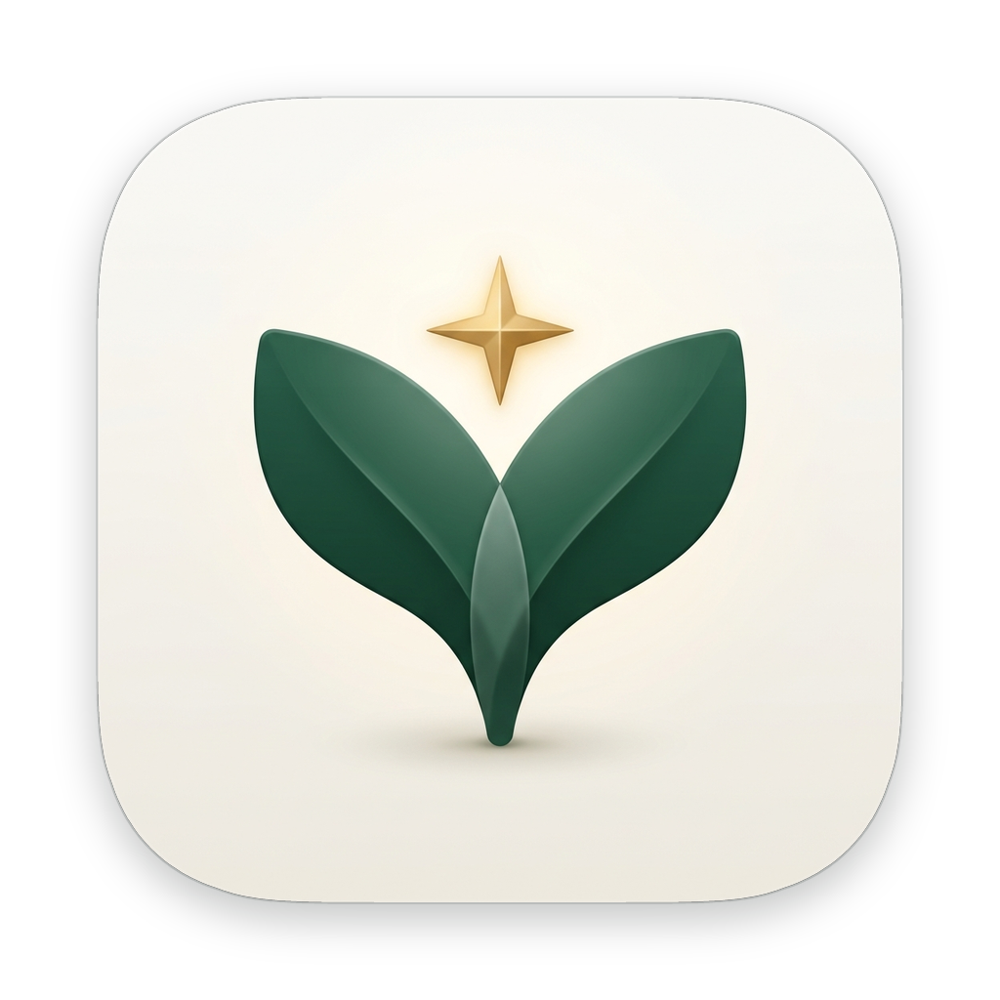

<p align="center">
  
</p>

<h1 align="center">成长决策顾问 · Decision Advisor</h1>

<p align="center">
  <strong>Local-First 个人成长决策顾问与双时间轴长期记忆引擎</strong><br/>
  <sub>原生 macOS SwiftUI 客户端（内置离线引擎 + 24/7 云端 VPS 双模切换） · 4 路中文混合语义检索 · 官方 ChatGPT OAuth 订阅直连 & Remote MCP</sub>
</p>

<p align="center">
  <a href="https://github.com/fengfe1125/decision-advisor/releases/tag/v0.12"></a>
  
  
  
  
</p>

---

## 为什么做「成长决策顾问」？

通用大模型擅长回答公共知识，却在面对**「我该不该接这个高压 Offer？」「为什么我总在类似的人际关系里内耗？」**这类人生具体选择时陷入两个极端：**要么顺着你的情绪给廉价安慰，要么给出放之四海皆准却与你无关的正确的废话**。

**成长决策顾问（Decision Advisor）** 将你的核心自我、人生章节、高情绪显著经历、重要关系与过往决策复盘沉淀为**纯 Markdown 本地记忆真源**，并通过一套严格的**反讨好决策协议**与**双时间轴混合检索引擎**，让 AI 成为真正了解你过往教训、敢于给你泼冷水的长期决策伴侣。

| 核心设计 | 解决的问题 | 实现方式 |
| :--- | :--- | :--- |
| **反讨好 9 步决策协议** | 拒绝顺从附和与空洞说教 | 每次决策强制全量读取 `00-核心自我`，引用真实 `[[历史事件]]`、至少 **1 条过往后悔/失败教训** 与 **1 个反方视角**，严格区分「事实 / 推断 / 价值判断」 |
| **纯 Markdown 真源 + 外置 Git** | 杜绝笔记软件锁定与 iCloud 同步冲突 | 记忆库保持 100% 纯净 Markdown；`.memory-git` 与 `advisor_state.db` 物理外置，每次写入/删除自动生成 Git 快照 |
| **4 路中文混合检索 + 双时间回溯** | 跨时间召回深层情绪模式，防止事后视角污染 | 离线中文向量 `BAAI/bge-small-zh-v1.5` (45%) + 词法 BM25 (20%) + `[[双链]]`/共现人物图谱扩散 (15%) + 显著性与双时间加权 (20%)，支持 `as_of` 历史时间切片 |
| **半自动提案确认 + 四级隐私防火墙** | 防止 AI 幻觉静默污染记忆库，保护绝密隐私 | 对话后自动提炼变更提案（核心自我变更强制展示前后 Diff 与证据），人工确认后落盘；`privacy: sensitive` 与 `<private>` 块在发往云端前物理剥离 |

---

## v0.12 核心特性

### 1. 原生 macOS 客户端（内置引擎 + 远程 VPS 双模无缝切换）
- **原生 SwiftUI + AppKit 架构**：采用静谧森林墨绿（Forest Ink）设计语言，完整适配 macOS 原生窗口质感、深浅色自适应主题、快捷键（`⌘\` 折叠侧边栏、`⌘N` 新建对话）与流式推理思考链折叠展示。
- **双引擎自由切换**：
  - **App 内置本地引擎（`embedded_local`）**：打开 App 自动拉起并守护内置 FastAPI 后端（`127.0.0.1:18789`），自动在 `~/Library/Application Support/DecisionAdvisor` 初始化独立 Python 运行时与本地数据目录，零命令行依赖。
  - **24/7 远程 VPS 引擎（`remote_vps`）**：支持一键切换至云端 HTTPS 服务端，多端实时同步会话历史、记忆图谱与时间轴，并支持**「一键将云端 Markdown 记忆库打包下载回本机 iCloud」**。
- **四大核心工作区**：
  - **💬 顾问对话**：支持 `日常倾诉 (chat)`、`9 步决策 (decision)`、`冷启动访谈 (interview)`、`周期反思 (reflect)` 四大模式，支持 `as_of` 历史回溯、敏感记忆临时授权开关与一键提炼记忆提案。
  - **📚 记忆与图谱**：按分类、情绪标签、显著性评分（`importance >= 7`）筛选浏览，内置**「人生事件时间轴」**、**「关联图谱关系网」**以及带 Git 原因说明的在线 Markdown 编辑器。
  - **📥 10 秒速记收件箱**：选择此刻心情与一句碎片念头，10 秒落盘至 `99-收件箱/inbox.md`，随时一键转入周期反思整理入库。
  - **⚙️ 模型与设置**：可视化管理连接模式、ChatGPT 订阅授权登录、5 大类模型预设、向量引擎重建与外置 Git 版本快照历史。

### 2. 官方合规接入 ChatGPT 订阅额度（OAuth 2.0 PKCE + Remote MCP）
- **首选 · 官方 Sign in with ChatGPT 授权直连**：
  - 内置完整的 OpenAI 官方 OAuth 2.0 PKCE + 动态客户端注册（`dynamic_agent_client` / `agent_name_hint=DecisionAdvisor` / `chatgpt.tokens.use.direct`）。
  - 在 App 设置中点击**「使用 ChatGPT 授权登录」**，即可通过 OpenAI 官方 `POST /v1/responses`（`store=false, stream=true`）与 `GET /v1/models` 直接调用你账号下的 **ChatGPT Plus / Pro / Go / Business 套餐额度与可用模型**，无需 API Key。
  - **跨设备/远程 VPS 回调捕获**：直连远程 VPS 时，macOS App 会在本机自动启动临时 `127.0.0.1` Loopback 回调捕获服务，浏览器授权完成后自动回传给远程后端完成 Token 交换；同时提供「手动粘贴回调链接」兜底。
- **官方 ChatGPT Developer Mode 远程 MCP（OAuth 2.1 PKCE）**：
  - 内置符合 RFC 9728 / RFC 8414 的 `/.well-known/oauth-protected-resource`、`/.well-known/oauth-authorization-server`、动态客户端注册与 PKCE 授权服务。
  - 在 ChatGPT 网页版或官方 iPhone App 中添加 `https://<你的域名>/mcp`，即可在官方客户端内直接调用 6 个工具：`get_core_self`、`search_memories`、`get_memory`、`get_timeline`、`add_inbox_note`、`save_memory`。

### 3. 全主流大模型统一协议栈
除 ChatGPT 订阅 OAuth 直连外，原生支持并针对最新推理模型协议做了自动适配：
- **DeepSeek 官方 / 兼容接口**：支持 `deepseek-v4-pro`、`deepseek-reasoner` 等，自动解析 `reasoning_content` 思考流并规避推理模型 `temperature` 报错。
- **OpenAI 兼容接口 / 中转站**：针对 `gpt-5.x` / `gpt-6.x` / `o1+` 系列自动切换 `max_completion_tokens` 并智能省略不兼容的 `temperature` 参数。
- **Claude 原生 API**：支持 `claude-sonnet-5-5` 等，针对 Claude 4.7+ 自动省略被弃用的 `temperature` 字段。
- **Gemini 原生 API**：支持 `gemini-4-neon` 等，原生支持 `:streamGenerateContent?alt=sse` 流式解析与 `thought` 思考摘要提取，并针对 Gemini 4+ 自动省略 `temperature`。

---

## 记忆库目录结构（Markdown 唯一真源）

```text
决策/
├── 00-核心自我/               # AI 每次决策必读（identity / values / patterns / boundaries / goals）
├── 01-人生章节/               # 按人生阶段记录身份转变、当时信念与现在回看
├── 02-经历与感受/             # 按年份归档具体事件，情绪是一等公民（强度/效价/触发点/身体反应）
├── 03-重要关系/               # 家人、伴侣、挚友、导师等重要人物档案与共同经历双链
├── 04-决策实验室/             # 进行中/ 与 已复盘/，记录选项、反方观点、预期结果与事后真实复盘
├── 05-认知演进与反思/         # 观点演变日志（保留旧认知被迭代的完整轨迹）与周期复盘
├── 99-收件箱/                 # 碎片速记暂存区（inbox.md），由 AI 半自动整理归档
└── _系统协议/                 # 顾问人格与 9 步工作协议、四级隐私与写入权限规范、标准笔记模板
```

---

## 快速开始

### 方式一：直接运行原生 macOS App（推荐）

1. 前往 [**Releases**](https://github.com/fengfe1125/decision-advisor/releases) 下载最新 `DecisionAdvisor-v0.12-macOS.zip`，解压后将 **`成长决策顾问.app`** 拖入 `/Applications`（应用程序）目录；
2. 或从源码一键编译并覆盖安装到本机 `/Applications`：
   ```bash
   ./macos/build_app.sh --install
   open "/Applications/成长决策顾问.app"
   ```
3. 首次打开 App 后：
   - 可在 **「⚙️ 模型与设置 → 连接与同步」** 中选择 **「App 内置本地引擎」** 或 **「远程 VPS (24/7 在线)」**；
   - 在 **「大模型」** 标签页点击 **「使用 ChatGPT 授权登录」**，或填入 DeepSeek / OpenAI / Claude / Gemini API Key，点击 **「保存并测试」** 即可开始对话。

> **签名说明**：macOS 安装包采用本地 ad-hoc 签名（未 Apple 公证）。若首次在另一台 Mac 打开提示无法验证开发者，可在终端执行 `xattr -cr "/Applications/成长决策顾问.app"` 后打开。

### 方式二：零后端体验离线交互式 Demo MVP

无需安装 Python 或配置 API Key，直接在浏览器打开 `demo-mvp/index.html`（或启动静态预览）即可体验完整交互流程：

```bash
python3 -m http.server -d demo-mvp 8088
# 浏览器访问 http://127.0.0.1:8088
```

### 方式三：启动本地纯 API 调试后端

```bash
cp config.example.json config.local.json
./start.sh
# 默认监听 http://127.0.0.1:8789/api/health
```

### 方式四：一键部署 24/7 远程 VPS 后端（API + Remote MCP）

```bash
# 仅更新 VPS 后端代码并清理缓存重启服务
./deploy/deploy-vps.sh

# 同步本地 iCloud 记忆库与配置到 VPS
./deploy/deploy-vps.sh --sync-vault
```

详细配置说明请参考：
- [远程后端与手机端接入指南 (`deploy/API-Mobile-Guide.md`)](./deploy/API-Mobile-Guide.md)
- [官方合规方式接入 ChatGPT Plus / Pro 订阅指南 (`deploy/VPS-ChatGPT订阅接入指南.md`)](./deploy/VPS-ChatGPT订阅接入指南.md)

---

## 仓库目录结构

```text
decision-advisor/
├── app/
│   ├── main.py                # FastAPI 纯 API 路由（SSE 流式对话、记忆读写、提案提取、整库导出）
│   ├── chatgpt_oauth.py       # OpenAI 官方 Sign in with ChatGPT (OAuth 2.0 PKCE + 动态客户端注册 + 自动续期)
│   ├── mcp_server.py          # ChatGPT Developer Mode 远程 MCP 服务端 + OAuth 2.1 PKCE 授权中心
│   ├── providers.py           # 多模型统一调用与 SSE 流式解析器（Responses API / DeepSeek / OpenAI / Claude / Gemini）
│   ├── search_index.py        # 4 路混合检索引擎（本地离线 BGE 中文向量 + BM25 + 双链/共现图谱 + 双时间回溯）
│   ├── memory_store.py        # Markdown 记忆库解析、四级隐私防火墙与 <private> 标签剥离
│   ├── prompts.py             # 9 步反讨好决策提示词组装与半自动记忆变更提案解析
│   ├── git_backup.py          # 外置 .memory-git 自动快照与历史查询（零 iCloud 污染）
│   ├── db.py                  # SQLite 会话历史、向量存储、图谱边与 OAuth 令牌持久化
│   └── config.py              # 本地/远程双模配置管理与凭据脱敏序列化
├── macos/
│   ├── Package.swift          # Swift 6.0 原生 macOS 客户端包定义（macOS 14.0+）
│   ├── build_app.sh           # 原生 .app 打包脚本（内置 Python 后端 + 图标生成 + LC_BUILD_VERSION 签名安装）
│   ├── Assets/                # 应用主图标（AppIcon.png / SVG）与指南针徽标
│   └── Sources/DecisionAdvisor/
│       ├── DecisionAdvisorApp.swift       # 应用入口、原生窗口与快捷键配置
│       ├── ContentView.swift              # 统一侧边栏与四栏工作区容器
│       ├── ChatView.swift                 # 流式对话、思考过程折叠、记忆引用胶囊与 Diff 提案确认弹窗
│       ├── MemoriesView.swift             # 记忆浏览、4 路语义检索、人生时间轴、关系图谱与在线编辑器
│       ├── InboxView.swift                # 10 秒情绪速记收件箱与近期速记流
│       ├── SettingsView.swift             # 双模连接切换、ChatGPT OAuth 登录面板、模型预设与索引管理
│       ├── EmbeddedBackendManager.swift   # App 内置 FastAPI 引擎生命周期与运行时自动供应管理
│       ├── LocalOAuthCallbackCatcher.swift# 远程 VPS 模式下的本机 127.0.0.1 OAuth 回调自动捕获器
│       ├── APIClient.swift                # 异步 HTTP + SSE 流式客户端
│       ├── AppState.swift                 # 全局响应式状态管理 (@Observable)
│       ├── Models.swift                   # API 领域模型定义
│       └── Theme.swift                    # Forest Ink 自适应深浅色主题系统
├── demo-mvp/                  # 纯前端零后端依赖的离线交互式 Demo MVP
├── deploy/                    # VPS systemd 服务单元、Caddy 配置示例、一键部署脚本与接入文档
├── tests/
│   └── test_app.py            # 全链路自动化测试（协议构建、4 路检索、隐私隔离、OAuth 2.1 MCP、ChatGPT OAuth）
├── config.example.json        # 配置文件模板
├── snapshot.sh                # 外置 Git 快照 CLI 脚本
└── start.sh                   # 本地纯 API 调试后端启动脚本
```

---

## 开发与测试

```bash
# 安装依赖并运行全量自动化测试
uv sync
uv run pytest -v

# 编译并打包原生 macOS App（自动覆盖安装至 /Applications/成长决策顾问.app）
./macos/build_app.sh --install
```
